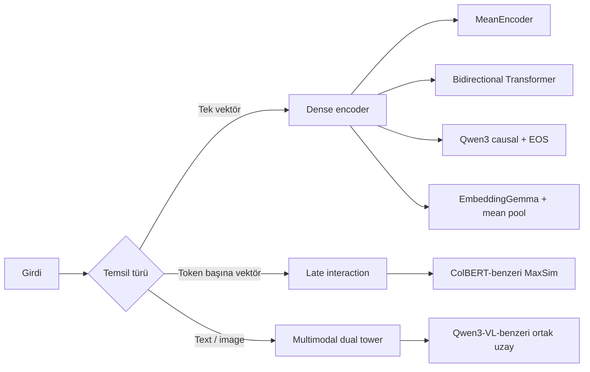
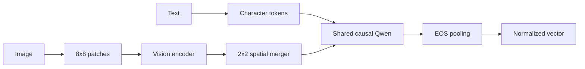

# Embedding Mimarileri — Derinlemesine Ders Rehberi

Bu rehber, 4. haftadaki kodları yalnızca çalıştırılacak örnekler olarak değil,
bir embedding sisteminin tasarım kararlarını okuyabileceğimiz küçük laboratuvarlar
olarak ele alır. Amaç, öğrencinin model kartlarında gördüğü şu ifadeleri gerçek
tensor işlemlerine çevirebilmesidir:

- dense bi-encoder;
- causal veya bidirectional attention;
- mean, attention veya last-token pooling;
- instruction-aware query/document encoding;
- late interaction ve MaxSim;
- Matryoshka Representation Learning;
- multimodal dual tower;
- exact ve approximate vector search.

Buradaki modeller aynı veri ve yakın kapasiteyle çalıştığı için farkı ölçekten
değil, **mimari karardan** okumak mümkündür.

---

## 1. Büyük resim

Bir embedding modeli, değişken uzunluklu girdiyi karşılaştırılabilir sabit
boyutlu bir vektöre dönüştürür:

```text
girdi x  ->  encoder f(x)  ->  z ∈ R^d

"ayşe"  -> [0.12, -0.03, ..., 0.41]
"ayse"  -> [0.10, -0.01, ..., 0.39]
```

Girdi görüntü olduğunda da aynı sözleşme korunabilir:

```text
text("ayse")   -> z_text  ┐
                          ├─ aynı vektör uzayı
image("ayşe") -> z_image ┘
```

Dokümanlar bir kere encode edilip saklanır; her sorguda yalnızca sorgu encode
edilir ve en yakın kayıtlar aranır.



---

## 2. Vektör uzayında benzerlik

### Dot product

```text
a · b = Σ_i a_i b_i
```

Hem yön hem uzunluk sonucu etkiler. Model vektör uzunluğunu serbestçe
büyütebiliyorsa büyük dot product her zaman daha iyi anlamına gelmez.

### Cosine similarity

```text
cos(a, b) = (a · b) / (||a||₂ ||b||₂)
```

Dense çıktılar `F.normalize(..., dim=-1)` ile birim uzunluğa getirilir:

```text
||a||₂ = ||b||₂ = 1  =>  cos(a, b) = a · b
```

Arama böylece tek matris çarpımına iner:

```text
queries   [Q,D]
documents [N,D]
scores = queries @ documents.T  # [Q,N]
```

Birim vektörlerde L2 ve cosine aynı sıralamayı verir:

```text
||a - b||² = 2 - 2 cos(a, b)
```

Bu nedenle metric adı kadar önemli soru şudur: **iki taraf da aynı şekilde
normalize edildi mi?**

---

## 3. Model neyi benzer saymayı öğreniyor?

Veride anlamsal açıklamalar veya isim kökenleri yoktur. Supervision iki görünüm
üreterek kurulur:

```text
anchor          positive
"mehmed"  <->   "mehmet"
"ayse"    <->   "ayşe"
"cagla"   <->   "çağla"
```

`augment.py` harf silme, yer değiştirme, ilişkili harfle değiştirme ve Türkçe
karakteri ASCII'ye katlama uygular. `c–ç`, `g–ğ`, `o–ö`, `u–ü` gibi küçük harf
çiftleri de tek-harf eğitim sinyali verir.

Bunlar fonetik altın standart değildir. Model yazımsal yakınlığı öğrenebilir;
isimlerin anlamını, kökenini veya gerçek kişiler arasındaki ilişkiyi bu veriden
öğrenemez. Embedding uzayı eğitim hedefinin aynasıdır.

---

## 4. MeanEncoder: dürüst baseline

Dosya: [`mean_encoder.py`](mean_encoder.py)

```text
ids [B,T]
 -> token embedding [B,T,64]
 -> PAD maskeli ortalama [B,64]
 -> Linear + GELU + Linear [B,32]
 -> L2 normalize
```

Masked mean pooling:

```text
pooled_b = Σ_t mask[b,t] * token[b,t] / Σ_t mask[b,t]
```

Model hızlı ve yorumlanabilirdir; fakat toplama sıradan bağımsızdır:

```text
mean(E[a], E[l], E[i]) = mean(E[i], E[l], E[a])
```

Dolayısıyla `ali` ve `ila` aynı token ortalamasına sahiptir. Sonraki MLP de aynı
girdiyi aldığı için kaybolan sırayı geri getiremez. Transformer'ın ne kazandırdığı
bu baseline sayesinde ölçülebilir.

---

## 5. Bidirectional Transformer

Dosyalar: [`attention.py`](attention.py), [`block.py`](block.py) ve
[`transformer_encoder.py`](transformer_encoder.py).

Model üretim yapmadığı için bütün geçerli token'lar birbirini görebilir:

```text
      a  l  i
  a   ✓  ✓  ✓
  l   ✓  ✓  ✓
  i   ✓  ✓  ✓
```

Blok:

```text
x = x + Attention(RMSNorm(x))
x = x + SwiGLU(RMSNorm(x))
```

Attention içinde:

1. `q`, `k`, `v` projection'ları oluşturulur.
2. Her head'in `q` ve `k` vektörü QK-Norm ile normalize edilir.
3. RoPE sıra bilgisini `q` ve `k` içine taşır.
4. Padding token'ları maskelenir.
5. Head çıktıları birleştirilip output projection uygulanır.

Token çıktıları attention pooling ile tek vektöre iner:

```text
s_t = wᵀ h_t
α   = softmax(s)
z   = Σ_t α_t h_t
```

Model hangi konumların daha ayırt edici olduğunu öğrenebilir.

---

## 6. Qwen3-Embedding: causal attention + EOS pooling

Klasör: [`../qwen3_embedding/`](../qwen3_embedding/)

Qwen3-Embedding klasik encoder yerine causal LLM omurgasını korur:

```text
<query>    a y s e <eos>
<document> a y ş e <eos>
```

Causal görünürlükte ilk token geleceği göremez; son `<eos>` bütün geçmişi görür:

```text
<query> -> <query>
a       -> <query> a
y       -> <query> a y
...
<eos>   -> bütün önceki token'lar + <eos>
```

Bu nedenle son katmandaki EOS hidden state dizi özeti olarak alınır:

```text
H [B,T,64]
last = mask.sum(-1) - 1
pooled = H[batch_index, last]  # [B,64]
```

### Instruction awareness

`<query>` ve `<document>` token'ları aynı metnin kullanım amacını ayırır. Büyük
modellerde bu rol doğal dil instruction'ı olabilir. Küçük model tek öğrenilen rol
token'ıyla aynı mekanizmayı görünür kılar.

Qwen bloğunun imzaları GQA, QK-Norm, RoPE, RMSNorm, pre-norm residual yapı ve
SwiGLU'dur. Resmî modeller büyük ölçeklidir; buradaki yaklaşık 78 bin parametreli
model yalnızca tensor akışını öğretir.

---

## 7. EmbeddingGemma: bidirectional + mean pooling

Klasör: [`../embedding_gemma/`](../embedding_gemma/)

```text
tokens [B,T,64]
 -> bidirectional Gemma blocks
 -> masked mean [B,64]
 -> Linear(64,256)
 -> Linear(256,32)
 -> L2 normalize
```

İki projection arasında aktivasyon yoktur:

```text
z = W_down (W_up pooled)
```

Matematiksel olarak tek matriste birleşebilse de eğitim/checkpoint tarifinde ayrı
tutulur. Küçük iç blokta sandwich RMSNorm, GeGLU, GQA, QK-Norm ve local/global
bidirectional attention gösterilir.

### Global Orthogonal Regularizer

Contrastive loss doğru eşin yanlış eşten yakın olmasını ister; bütün vektörlerin
uzayın küçük bir köşesine yığılmasını doğrudan engellemez. GOR iki hedef ekler:

```text
mean(z) ≈ 0
E[z zᵀ] ≈ I / d
```

Kod karşılığı:

```text
second_moment = Z.T @ Z / batch_size
target        = eye(d) / d
gor           = mse(second_moment, target) + mean(Z)^2
```

İlk terim yönleri uzaya yayar, ikinci terim bulut merkezini orijine iter. Test,
karşılıklı `±basis` vektörlerinin üst üste binmiş vektörlerden daha düşük GOR
verdiğini doğrular.

---

## 8. Late interaction ve MaxSim

Dosya: [`late_interaction.py`](late_interaction.py)

Dense model ad başına tek vektör; late-interaction model token başına bağlamsal
vektör saklar:

```text
"çağla" -> 5 × [32]
```

Sorgudaki her token dokümandaki en iyi eşini seçer:

```text
score(q,d) = mean_i max_j cosine(q_i, d_j)
```

Tensor akışı:

```text
Q          [B,Tq,D]
K          [C,Td,D]
similarity [B,C,Tq,Td] = einsum("bqd,ckd->bcqk")
maxsim     [B,C,Tq]    = max over Td
score      [B,C]       = masked mean over Tq
```

Tek-vektör darboğazı azalır ve eşleşmenin hangi token'lar arasında olduğu
korunur. Bedeli, doküman başına token sayısı kadar vektör ve daha pahalı aramadır.
Bu kod ColBERT'in ana fikrini gösterir; üretim indeksini yeniden uygulamaz.

---

## 9. Qwen3-VL-Embedding: text ve image ortak uzayda

Klasör: [`../qwen3_vl_embedding/`](../qwen3_vl_embedding/)



### Görüntü şekilleri

```text
images [B,1,32,96]
8×8 patch -> 4×12 grid -> patches [B,48,32]
2×2 merger -> 2×6 grid -> visual_tokens [B,12,64]
```

Merger dört komşu patch'i birleştirir:

```text
4 patch × 32 dim -> concat 128 -> merger MLP -> 64
```

Text token'larına text modality, image token'larına image modality embedding'i
eklenir. Her dizinin sonuna öğrenilen EOS gelir:

```text
text_tokens  + text_modality  + EOS -> Qwen -> z_text
image_tokens + image_modality + EOS -> Qwen -> z_image
```

Symmetric contrastive loss `text("ayse")` ile `image("ayşe")`yi yakınlaştırır.
`encode_fused()` ise `[image tokens][text tokens][EOS]` dizisiyle karışık girdiyi
tek vektöre çevirir. Fused yolun iyi kalite vermesi ayrıca mixed-modal supervision
gerektirir.

Resmî seri görüntü, screenshot ve videoyu destekler. Burada tek kanallı küçük isim
görselleri ve sentetik font kullanılır; amaç mekanizmadır, kalite eşdeğerliği değil.

---

## 10. Contrastive öğrenme

Batch'te `B` doğru çift için skor matrisi:

```text
S_ij = cosine(q_i, d_j) / temperature
```

Doğru eşler diagonaldedir:

```text
             ayşe  mehmet  çağla
query ayse    9.1    1.2    0.8
query mehmed  0.4    8.7    1.1
query cagla   1.0    0.7    8.4
```

Symmetric InfoNCE:

```text
L = 0.5 * (CE(S, diagonal) + CE(S.T, diagonal))
```

`temperature=0.07` küçük skor farklarını keskinleştirir. Batch'teki diğer
`B-1` doküman her sorgu için negative olur. Batch büyüdükçe negatif çeşitliliği
artar; gerçekte eşdeğer iki kayıt birbirini iterse false negative oluşur.

---

## 11. Matryoshka: tek checkpoint, çok boyut

```text
z[:8] ⊂ z[:16] ⊂ z[:32]

L_MRL = mean(
    L_contrastive(z[:8]),
    L_contrastive(z[:16]),
    L_contrastive(z[:32])
)
```

Inference'ta kesit yeniden normalize edilmelidir:

```python
small = torch.nn.functional.normalize(full[:, :8], dim=-1)
```

Tam vektörün normu 1 olsa da ilk sekiz boyutun normu 1 değildir.

Bir milyon FP32 vektör için ham bellek:

| Boyut | Bellek |
| ---: | ---: |
| 32 | yaklaşık 128 MB |
| 16 | yaklaşık 64 MB |
| 8 | yaklaşık 32 MB |

Daha az boyut daha az bellek ve daha hızlı arama; potansiyel kalite kaybı
demektir.

---

## 12. Vector index model değildir

[`vector_store.py`](vector_store.py) şu sözleşmeyi uygular:

```text
add:    (text, vector)
search: query_vector -> top-k [(text, score)]
save:   vectors + metadata
load:   aynı uzayı geri getir
```

Exact search:

```text
scores = query @ all_document_vectors.T
```

921 isim için bütün satırları taramak doğru ve basittir. HNSW/IVF gibi ANN
indekslerine erken geçmek model hatasıyla approximation hatasını karıştırabilir.

Model checkpoint'i, tokenizer, Unicode normalizasyonu, instruction şablonu,
embedding boyutu veya pooling değişirse yeni indeks oluşturulmalıdır. İki model
32 boyut üretiyor diye aynı koordinat sisteminde değildir.

---

## 13. Değerlendirme

```text
Recall@k = ilk k sonuçta doğru dokümanı bulunan sorgu oranı
```

Bu repodaki validation:

1. Temiz adları train/validation ayırır.
2. Validation adından bozuk sorgu üretir.
3. Temiz validation adlarını aday yapar.
4. Doğru temiz ad birinciyse isabet sayar.

Gerçek rapor en az şunları içermelidir:

- `Recall@1` ve `Recall@5`;
- embedding ve query latency;
- indeks boyutu;
- başarı örnekleri;
- en az beş hata ve kategorisi;
- aynı split'te lexical baseline.

Üç elle seçilmiş demo sorgusu benchmark değildir.

---

## 14. Adil karşılaştırma protokolü

```text
aynı seed
aynı train/validation split
aynı batch size
aynı positive üretimi
aynı adım sayısı
aynı candidate pool
aynı Recall@k kodu
```

| Model | Params | Vektör/ad | Dim | Recall@1 | Index MB | Query ms |
| --- | ---: | ---: | ---: | ---: | ---: | ---: |
| Mean |  | 1 | 32 |  |  |  |
| Transformer |  | 1 | 32 |  |  |  |
| Qwen3 EOS |  | 1 | 32 |  |  |  |
| EmbeddingGemma |  | 1 | 32 |  |  |  |
| Late interaction |  | T | 32 |  |  |  |
| Qwen3-VL text→image |  | 1 | 32 |  |  |  |

Küçük veri ve kısa isimlerde basit mean model daha büyük modelden iyi çıkabilir.
Bu başarısızlık değil, görev/veri/kapasite uyumudur.

---

## 15. Derste izlenecek kod sırası

### Gün 1

1. [`by_hand.py`](by_hand.py): cosine, InfoNCE, MaxSim, Matryoshka.
2. [`tokenizer.py`](tokenizer.py): PAD ve Unicode.
3. [`mean_encoder.py`](mean_encoder.py): baseline ve sıra kaybı.
4. [`attention.py`](attention.py): bidirectional attention.
5. [`transformer_encoder.py`](transformer_encoder.py): pooling.
6. [`losses.py`](losses.py): symmetric InfoNCE.
7. `qwen3_embedding/model.py`: EOS pooling.
8. `embedding_gemma/model.py`: mean pooling ve linear neck.

### Gün 2

1. [`vector_store.py`](vector_store.py): exact cosine index.
2. [`build_index.py`](build_index.py): offline indexing.
3. [`demo.py`](demo.py): query ve top-k.
4. [`late_interaction.py`](late_interaction.py): MaxSim.
5. `qwen3_vl_embedding/vision.py`: patch ve merger.
6. `qwen3_vl_embedding/model.py`: text/image/fused yolları.
7. [`EXERCISES.md`](EXERCISES.md): proje sözleşmesi.

---

## 16. Sık yapılan hatalar

- **Padding'i ortalamaya katmak:** masked mean kullanın.
- **MRL kesitini normalize etmemek:** her prefix'i yeniden normalize edin.
- **Query/document rollerini karıştırmak:** kod çalışır, kalite sessizce düşer.
- **Eski ve yeni checkpoint'i aynı indekste kullanmak:** koleksiyonu sürümleyin.
- **Demo sonucunu benchmark saymak:** sabit etiketli query set kullanın.
- **Sentetik fontla yetinmek:** gerçek multimodal projede font, crop, blur,
  fotoğraf ve screenshot çeşitliliği ekleyin.

---

## 17. Hangi mimari ne zaman?

| İhtiyaç | Başlangıç seçimi | Neden |
| --- | --- | --- |
| Küçük veri, hızlı baseline | MeanEncoder | ucuz ve yorumlanabilir |
| Genel dense retrieval | Bidirectional Transformer | bağlam + tek vektör |
| Instruction-aware LLM retrieval | Qwen3 EOS | causal omurga ve rol prompt'u |
| On-device küçük text encoder | EmbeddingGemma yolu | mean pool, MRL ve GOR |
| İnce token eşleşmesi | Late interaction | MaxSim ayrıntıyı korur |
| Text→image/screenshot | Qwen3-VL yolu | ortak multimodal uzay |

Bu tablo sonuç değil, deney başlangıç noktasıdır. Seçim gerçek domain verisinde
ölçülmelidir.

---

## 18. Dürüstlük sınırı

Repo içindeki aile adları mimari ilhamı belirtir. Resmî checkpoint uyumluluğu,
yayımlanmış benchmark kalitesi, aynı tokenizer/veri/kernel/context iddiası yoktur.

Rehber şu mekanik soruları cevaplamayı hedefler:

- Causal embedding neden son token'ı kullanır?
- Bidirectional model neden mean pooling yapabilir?
- Instruction token tensor akışını nasıl değiştirir?
- Late interaction neden daha fazla indeks alanı ister?
- Vision patch'leri language backbone'a nasıl bağlanır?
- MRL neden prefix'leri ayrı ayrı eğitir?
- GOR embedding bulutunun geometrisini nasıl etkiler?

Bu ayrım, mimariyi anlamakla model adını ezberlemek arasındaki farktır.

## Birincil kaynaklar

- [Sentence-BERT](https://arxiv.org/abs/1908.10084)
- [SimCSE](https://arxiv.org/abs/2104.08821)
- [ColBERT](https://arxiv.org/abs/2004.12832)
- [Matryoshka Representation Learning](https://arxiv.org/abs/2205.13147)
- [Qwen3 Embedding](https://arxiv.org/abs/2506.05176)
- [EmbeddingGemma](https://arxiv.org/abs/2509.20354)
- [Qwen3-VL-Embedding](https://arxiv.org/abs/2601.04720)
